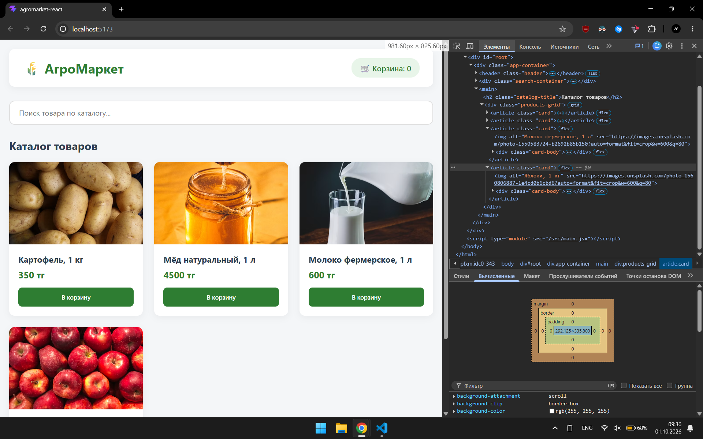
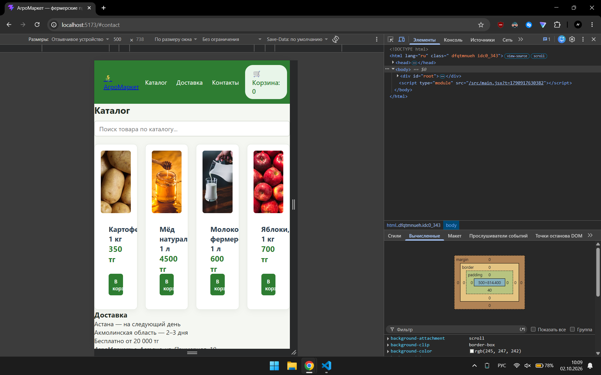
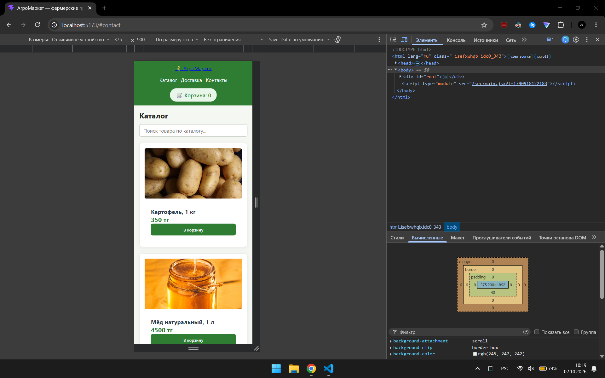
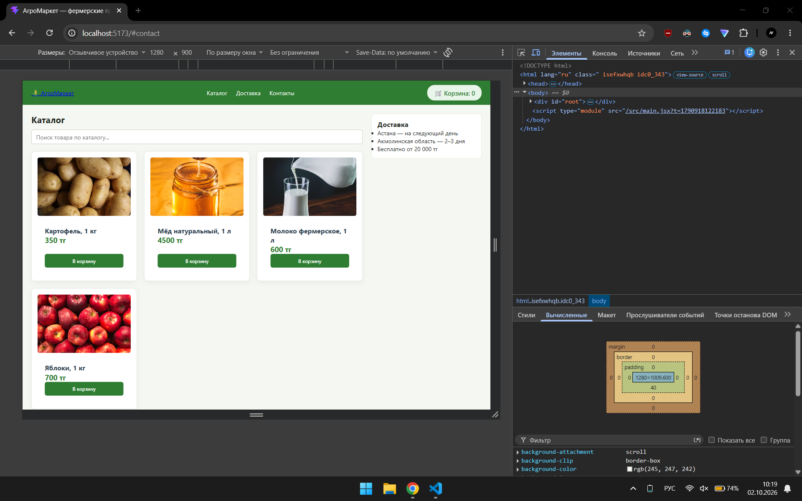
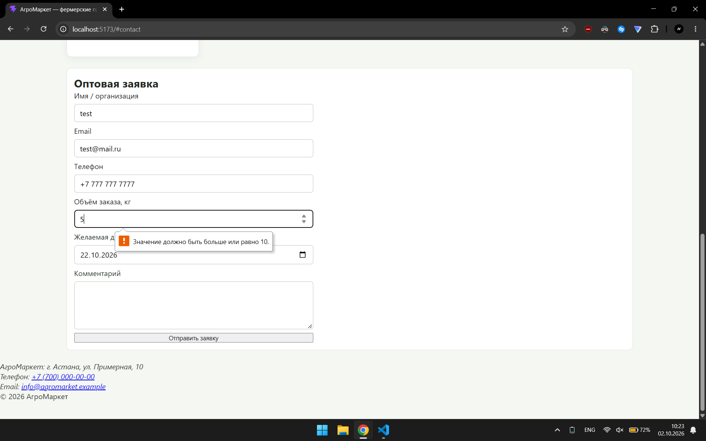
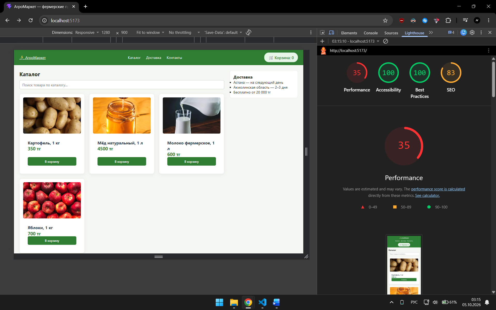
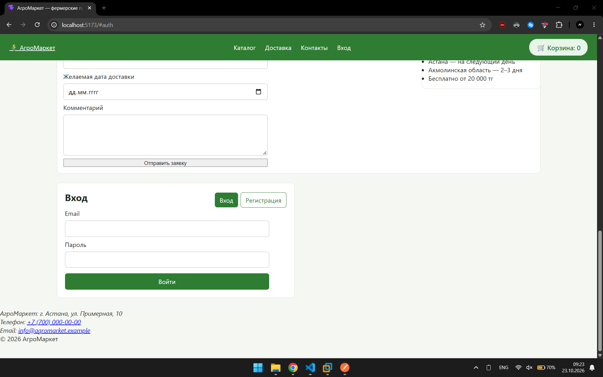
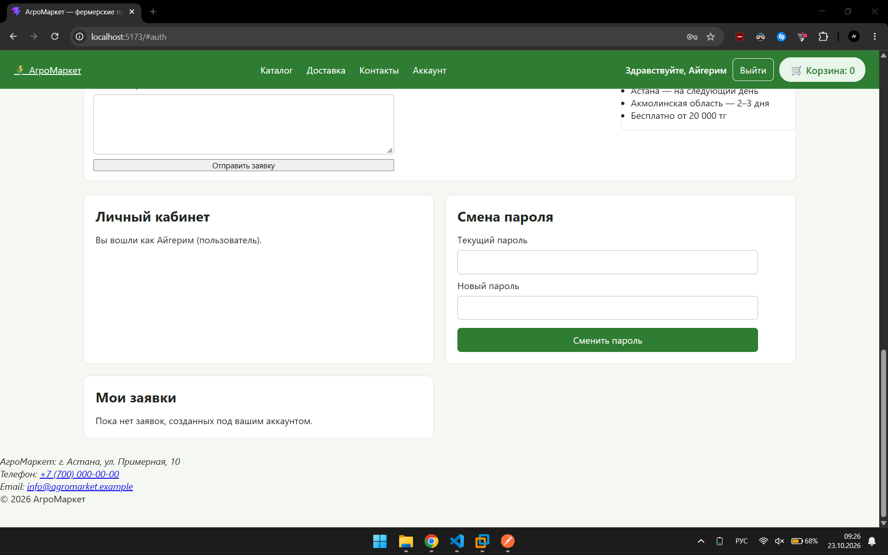
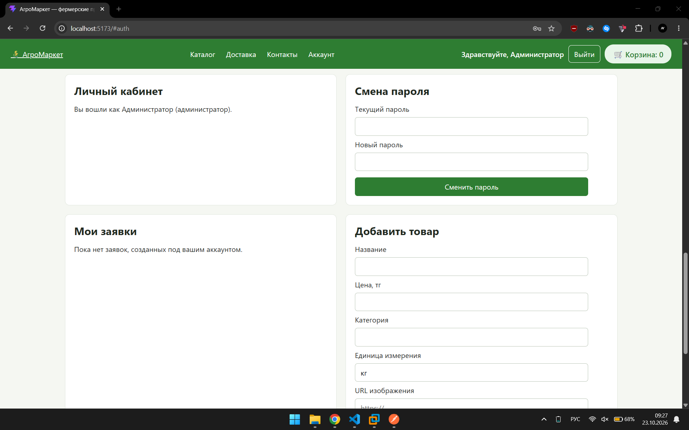

# АгроМаркет — React + Vite

Frontend проекта: каталог, поиск, корзина и оптовая заявка, а с ЛР7 — вход, регистрация и панель администратора.

## Лабораторная 4 — вёрстка

### 1. Box model карточки

- content: 292.125 px
- padding: 0
- border: 0
- margin: 0
- итоговая ширина: примерно 292.125 px

При добавлении `box-sizing: border-box` ширина карточки не изменилась, потому что свойство уже применялось глобально через селектор `*`.



### 2. repeat(4, 1fr) на узком экране

При ширине около 500 px четыре фиксированные колонки становятся слишком узкими, карточки сжимаются, поэтому фиксированная сетка плохо подходит для адаптивной страницы.



### 3. auto-fit vs auto-fill

`auto-fit` схлопывает пустые колонки и позволяет существующим карточкам занимать освободившееся место.

`auto-fill` сохраняет место под возможные пустые колонки.

В проекте оставлен `auto-fit`.

### 4. Адаптивность

| Ширина | Колонок в каталоге | Где «Доставка» | Шапка |
|--------|---------------------|----------------|-------|
| 375 px | 1 | Под каталогом | Столбик |
| 768 px | 2–3 | Под каталогом | Ряд |
| 1280 px | Несколько колонок | Справа от каталога | Ряд |

#### 375 px



#### 1280 px



### 5. HTML5-валидация формы

Форма использует:

- `type="text"`;
- `type="email"`;
- `type="tel"`;
- `type="number"`;
- `type="date"`;
- `required`;
- `min="10"`.

Браузер автоматически блокирует отправку при некорректном email и при объёме заказа меньше 10 кг.



### 6. Что реализовано

- Семантические `header`, `nav`, `main`, `section`, `aside`, `footer`;
- отдельные компоненты `Header`, `Footer`, `ContactForm`;
- Flexbox для шапки, панели каталога и карточек;
- CSS Grid для каталога;
- `repeat(auto-fit, minmax(220px, 1fr))`;
- featured-карточка «Товар недели»;
- адаптивность mobile-first;
- media queries для 768px и 1024px;
- форма оптовой заявки;
- HTML5-валидация.

### 7. Запуск проекта

Команды выполняются из корня проекта.

Терминал 1:

```bash
npx json-server --watch db.json --port 3001
```

Терминал 2:

```bash
npm run dev
```

После этого проект открывается на: [http://localhost:5173](http://localhost:5173).

### Lighthouse Accessibility

Первичная проверка Lighthouse показала:

- Accessibility: 96/100
- замечание: недостаточный контраст текста и фона.

После корректировки цветов и повторной проверки:

- Accessibility: 100/100

Проблема контраста была устранена без изменения структуры страницы.



### Бонусные задания

Выполнено:

- Lighthouse Accessibility — 100/100;
- макет `.page` переписан через `grid-template-areas`;
- боковая панель «Доставка» на десктопе сделана `sticky`;
- шапка сделана `sticky`.

## Лабораторная №7 — вход, роли и бонусы

### Запуск

Backend должен работать на `http://localhost:3000`, а его PostgreSQL — в Ubuntu
VMware по адресу `192.168.174.10:5432`. Frontend запускается из этого каталога:

```bash
npm install
npm run dev
```

Откройте `http://localhost:5173`. При необходимости задайте
`VITE_API_URL=http://localhost:3000/api` в локальном `.env`; значение по
умолчанию уже соответствует учебному стенду. Секреты в Vite-переменные не
помещайте: они попадут в браузерный код. Инструкция выше по запуску
`json-server` относится только к историческому этапу ЛР4 и для ЛР7 не нужна.

### Вход и интерфейс

Форма [LoginForm](./src/components/LoginForm.jsx) переключается между входом и
регистрацией. После успешного ответа JWT хранится в `localStorage`, имя
пользователя появляется в шапке, доступна кнопка выхода. После F5 приложение
вызывает `GET /api/auth/me`: недействительный или просроченный токен удаляется,
показывается форма входа. Запросы выполняются через
[apiFetch](./src/api.js), который добавляет Bearer-токен и показывает ошибки API.

Каталог, поиск, счётчик корзины и форма оптовой заявки сохранены. Гость может
отправить заявку без входа. Заявка вошедшего пользователя связывается с его
аккаунтом и появляется в разделе «Мои заявки»; раздел не показывает чужие
заявки. Доступ к данным проверяется на backend, скрытие элементов интерфейса
само по себе защитой не считается.

Администратор дополнительно видит [AddProductForm](./src/components/AddProductForm.jsx),
кнопки удаления товаров и панель заявок. Добавление и удаление обновляют
каталог без перезагрузки. Удаление требует подтверждения. В панели можно
изменить статус заявки; пользователям без роли admin панель не показывается.
Для вошедших пользователей доступна форма смены пароля.

### Четыре бонуса

1. Мои заявки — `GET /api/orders/my` и связь новых заявок с аккаунтом.
2. Удаление товара — подтверждение и `DELETE /api/products/:id` для admin.
3. Смена пароля — форма и `PATCH /api/auth/password`.
4. Панель заявок — просмотр и изменение статуса для admin.

Сообщения 401 завершают сеанс и предлагают войти снова; сообщения 403
показываются рядом с действием. Пароли и JWT не записываются в журнал браузера.

### Проверки и снимки

Для ЛР7 `npm run lint` и `npm run build` прошли. Проверки записи в рабочую БД
для создания скриншотов не запускались. Существующие снимки в
[`screenshots/lab4/`](./screenshots/lab4/) относятся к ЛР4. Снимки ЛР7 ниже
показывают форму входа с вкладкой регистрации, интерфейс обычного пользователя
и административную форму товара. Пароли и JWT на них не видны.





Безопасная папка Postman Runner в backend завершилась с результатом
**20 passed, 0 failed, 0 skipped, 0 errors**. Проверки изменяющего CRUD на
рабочей базе этим результатом не подтверждаются.

## Lab 8: API environment and verification

The API address comes from `VITE_API_URL`. `.env.development` sets the local backend to `http://localhost:3000/api`; copy `.env.example` for another environment and set the public API URL before building. Vite variables are included in browser JavaScript, so never place passwords, JWT values, or other secrets in a `VITE_` variable.

```bash
npm ci
npm run dev
npm run lint
npm test
npm run build
```

The `apiFetch` helper continues to add the stored JWT and handle API responses. The `React CI` workflow runs install, lint, and build on Pull Requests and pushes to `main`. `LoginForm` has a component test for the registration-only name field.